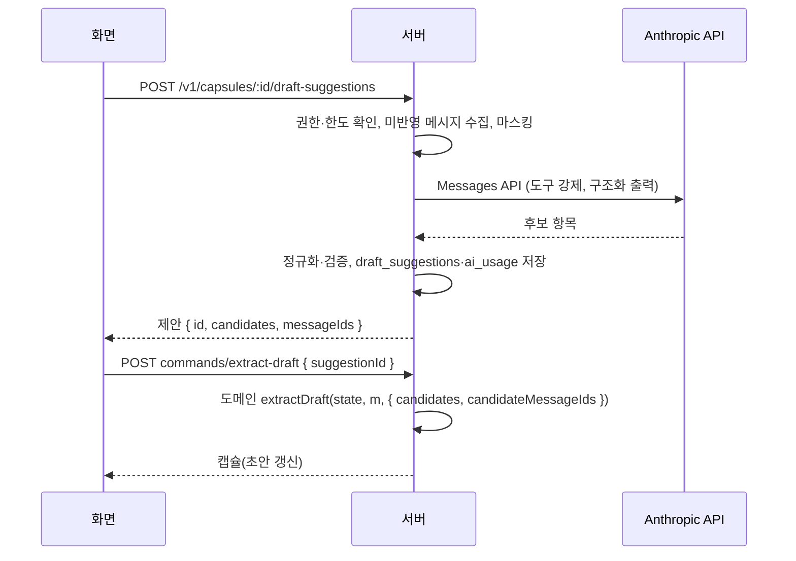

# AI 회의록 추출 계약 v1.1

상태: 승인됨 · 2026-11-20.

v1.1: 비용 때문에 **개발과 평가는 Google Gemini 무료 등급(`gemini-3.5-flash`)으로 하고, 운영 AI는 기본으로 꺼 둔다**. 운영에서 켤 때 쓸 모델은 Anthropic Claude `claude-haiku-5-5`(월 상한 $10)이며, 켜기 전에 Haiku로 시험 세트를 다시 측정해 통과선을 확인한다. 근거는 [Claude 모델 개요](https://platform.claude.com/docs/en/models/overview)와 [Gemini 요금](https://ai.google.dev/gemini-api/docs/pricing)이다. (2026-11-23: `gemini-3.8-flash`는 과부하 503이 잦아 기본을 `gemini-3.5-flash`로 바꿨다. 무료 등급은 모델당 하루 20회.)

Gemini 무료 등급은 Google 요금표에 "콘텐츠가 제품 개선에 사용됨"이라고 되어 있다. 그래서 **실제 사용자 대화는 Gemini로 보내지 않는다.**
- 서버는 `NODE_ENV=production`에서 `AI_PROVIDER=gemini`이면 시작을 거부한다.
- Gemini에는 평가 세트처럼 직접 만든 데이터만 보낸다.

AI는 **제안만** 한다. 초안에 들어가는 항목은 기존과 같은 코드 검증(근거 메시지 존재, 담당자 소속, 날짜 형식)을 거치고, 참여자의 공동 확인을 받는다. 규칙 기반 추출(`결정:` 같은 접두어)은 그대로 남긴다. AI를 쓸 수 없을 때는 사용자에게 그 사실을 알리고 규칙 기반으로 정리한다.

## 흐름



모델 호출은 DB 트랜잭션 밖에서 한다. 두 번째 단계(`extract-draft`)만 기존 명령 규칙(멱등 키, `expectedVersion`, 잠금)을 따른다.

## API

### `POST /v1/capsules/:id/draft-suggestions`
- 권한: 참여자. 허용 상태: open, review. `Idempotency-Key`가 필요하고 `expectedVersion`은 받지 않는다.
- 대상은 아직 초안에 반영되지 않은 메시지(`draftMessageIds`에 없는 것)다. 하나도 없으면 `422 domain_rule` "새 대화가 없어요."
- 맥락: 첫 초안이면 `sourceMessages`(위임 원문)도 함께 보낸다. 초안이 이미 있으면 기존 초안 항목의 text만 중복 방지용으로 보낸다.
- 응답 200: `{ "id", "capsuleId", "basedOnVersion", "messageIds": [...], "candidates": { "decisions", "tasks", "unresolved", "events" }, "model", "usage": { "inputTokens", "outputTokens", "costUsd" } }`
- 오류:

| HTTP | code | 상황 |
| --- | --- | --- |
| 429 | `ai_budget_exceeded` | 이번 달(KST) 누적 비용 + 이번 요청 예상 비용이 `AI_MONTHLY_BUDGET_USD`를 넘음 |
| 429 | `rate_limited` | 사용자당 시간당 `AI_USER_HOURLY_LIMIT`회 초과 |
| 503 | `ai_unavailable` | 키가 없거나, 공급자 오류, 20초 시간 초과, 출력이 스키마에 맞지 않음 |

### `extract-draft` 명령 확장
- payload `{}`: 기존 규칙 기반(변경 없음).
- payload `{ "suggestionId" }`: 같은 캡슐의 제안이고 만든 지 1시간 이내여야 한다. 아니면 `422 domain_rule`.
  - 제안의 `messageIds` 중 이미 반영된 것은 건너뛴다.
  - 제안 뒤에 온 메시지는 미반영으로 남는다.
  - 같은 제안은 한 번만 적용한다. 두 번째 적용은 `422`.

## 후보 항목 스키마 (서버 정규화 이후, 도메인 입력)

| 종류 | 필드 |
| --- | --- |
| decisions | `text`, `evidenceIds[]` |
| tasks | `text`, `ownerId`(멤버 id 또는 null), `dueAt`(ISO 또는 null), `dateText`, `evidenceIds[]` |
| unresolved | `text`, `evidenceIds[]` |
| events | `text`, `at`(ISO 또는 null), `hasTime`, `dateText`, `location`, `participantIds[]`, `kind`(`event`/`next`), `evidenceIds[]` |

공통 규칙:
- 모든 항목에 `source: "ai"`를 붙인다.
- `evidenceIds`는 보낸 메시지 id만 허용한다. 근거가 하나도 남지 않은 항목은 버린다.
- 담당자가 여럿이면 담당자마다 task를 하나씩 만든다(같은 text). 도메인 task는 담당자 하나다.
- 모델이 낸 담당자·참여자 id가 캡슐 참여자가 아니면 null이나 빈 배열로 바꾼다. 지어낸 값을 쓰지 않는다.
- 날짜: 모델은 KST 오프셋을 붙인 ISO로 낸다.
  - 서버는 파싱 가능한지, 근거 메시지 시각 기준 −1일부터 +400일 안인지 확인하고, 아니면 null(확인 필요)로 바꾼다.
  - 모호한 날짜·시각은 null이 정답이다.
  - 시각 없는 일정은 `hasTime: false`.

## 개인정보
- 보내는 것: 대상 메시지 본문과 시각, 작성자 id, 멤버 id 목록. 이름은 보내지 않는다. 본문 속 멤버 이름(성명, 이름만, "~씨" 등 호칭 포함)은 `@<id>`로 바꾼다.
- 가리는 것: 전화번호, 계좌·카드 번호처럼 보이는 숫자열, 이메일. `[전화]`, `[계좌]`, `[이메일]`로 바꾼다.
- 로그·DB에는 메시지 본문과 모델 원문 출력을 남기지 않는다. 제안 테이블에는 정규화된 후보만 저장한다. 사용 기록은 토큰 수와 비용만 남긴다.

## 비용·한도
- `ai_usage`에 요청마다 모델, 입출력 토큰, 비용(USD), 사용자, 조직, 캡슐을 기록한다.
- 비용 계산 단가는 환경 변수로 받는다. 기본값은 보수적으로 잡는다.
- 요청 전에 예상 비용(입력 토큰 추정 + `max_tokens` 상한)으로 월 상한을 확인한다.

## 환경 변수

| 이름 | 기본값 | 용도 |
| --- | --- | --- |
| `AI_PROVIDER` | `anthropic` | `anthropic` 또는 `gemini`. `gemini`는 운영(`NODE_ENV=production`)에서 시작 거부 |
| `ANTHROPIC_API_KEY` | (없음) | provider가 anthropic인데 없으면 제안 API는 503 `ai_unavailable`. 운영 기본은 미설정(AI 꺼짐) |
| `GEMINI_API_KEY` | (없음) | 개발·평가 전용 |
| `AI_MODEL` | provider별 `claude-haiku-5-5` / `gemini-3.5-flash` | 모델 id |
| `AI_MONTHLY_BUDGET_USD` | `10` | 월 상한(KST 월) |
| `AI_USER_HOURLY_LIMIT` | `20` | 사용자당 시간당 요청 수 |
| `AI_PRICE_INPUT_PER_MTOK` / `AI_PRICE_OUTPUT_PER_MTOK` | `1` / `5` | 비용 계산 단가(USD). 실제 요금보다 높게 잡아 상한을 지킨다 |

## 서버 모듈 (`server/src/extract/`)

```ts
export interface ExtractInput {
  messages: { id: string; authorId: string; text: string; createdAt: string }[]; // 대상
  context: { id: string; authorId: string; text: string; createdAt: string }[]; // 위임 원문 등, 근거로도 사용 가능
  existingTexts: string[]; // 기존 초안 항목(중복 방지)
  members: { id: string; name: string }[]; // 캡슐 참여자. 이름은 마스킹에만 쓰고 모델에 보내지 않는다
  referenceTime: string;
  timeZone: string; // 'Asia/Seoul'
}
export interface ExtractResult {
  candidates: Candidates; // 위 스키마, 정규화 완료
  usage: { inputTokens: number; outputTokens: number; costUsd: number };
  model: string;
}
export interface Extractor {
  extract(input: ExtractInput): Promise<ExtractResult>;
}
```

- `createAnthropicExtractor({ apiKey, model, fetch, prices })`: 도구 하나를 강제(`tool_choice`)해 구조화 출력을 받는다. 프롬프트는 `prompt.ts` 한 곳에 둔다.
- `createGeminiExtractor({ apiKey, model, fetch, prices })`: 같은 프롬프트와 같은 출력 스키마를 Gemini의 구조화 출력(JSON 스키마)으로 받는다. 무료 등급이면 비용은 0으로 기록한다. 프롬프트 조정은 Gemini로 하지만, 운영 전환 전에 Haiku로 다시 측정해야 한다.
- `mask.ts`, `normalize.ts`는 모델과 무관한 순수 함수로 만들고 단위 테스트한다.
- 평가 도구(`eval/extraction/run-ai.mjs`)는 같은 `Extractor`를 직접 불러 쓴다.

## 평가 기준 (시험 세트, 프롬프트 조정에 쓰지 않은 사례)

| 지표 | 통과선 |
| --- | --- |
| 전체 F1 | ≥ 85% (규칙 기반 69%) |
| 자연어(`natural`) F1 | ≥ 75% (규칙 기반 33%) |
| 정밀도 | ≥ 90% (지어낸 항목 최소화) |
| 날짜 정확도(일치 항목) | ≥ 90% |
| 모호 사례에서 값을 지어내지 않음(`ambiguous-*`의 담당·날짜가 null) | ≥ 95% |
| 사례당 평균 비용 | 보고만 함 |

통과선에 못 미치면 운영에서 AI 초안을 켜지 않는다(`ANTHROPIC_API_KEY` 미설정과 같은 동작).
