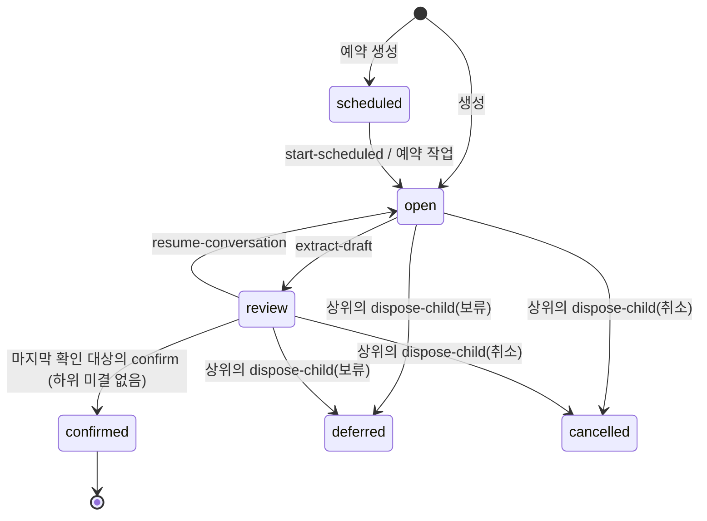

# 권한·상태 계약 v0

서버는 모든 조회·명령·WebSocket 구독에서 아래 표를 강제한다. 클라이언트 검사는 표시용일 뿐이다. 도메인 함수가 이미 하는 검사(`assertMember`, `facilitator`, `requireOpen` 등)는 유지하고, 서버는 그 앞에서 조직·세션·revision 검사를 추가한다.

## 역할

| 역할 | 정의 |
| --- | --- |
| 조직 관리자 | `org_members.role = 'admin'` |
| 조직 멤버 | `org_members`에 있고 `left_at`이 null |
| 참여자 | `capsule_members`에 있고 `departed_at`이 null |
| 진행자 | `capsules.facilitator_id`. 없으면 첫 참여자 |
| 확인 대상 | 참여자 중 `is_confirmation_target = true` |
| 상위 참여자 | 부모 캡슐의 참여자. 하위 캡슐의 `conclusions`만 볼 수 있다 |

조직 관리자라도 참여하지 않은 캡슐의 메시지를 읽을 수 없다. 관리 기능은 조직·초대·멤버 정보에 한정한다.

## 명령별 권한과 상태

| 명령 | 누가 | 허용 상태 | 비고 |
| --- | --- | --- | --- |
| 캡슐 생성 | 조직 멤버 | – | 생성자는 자동 참여자·진행자. `memberIds`는 같은 조직 멤버만 |
| `send-message` | 참여자 | open, review | review 중 메시지는 "미반영"으로 표시 |
| `delegate` | 참여자 | open, review | 선택 메시지는 이 캡슐의 메시지여야 함. 담당자는 조직 멤버 |
| `extract-draft` | 참여자 | open, review | |
| `update-draft-item` / `remove-draft-item` / `restore-draft` | 참여자 | review | 실제 변경이면 revision +1, 이전 확인 무효 |
| `resume-conversation` | 참여자 | review | 초안·이력 보존 |
| `confirm` | 확인 대상 | review | 확인 레코드는 현재 `revision`·`member_set_version`·`conclusion_version`에 묶음 |
| `set-confirmation-members` | 진행자 | open, review | 사유 필수, `member_set_version` +1 |
| `mark-member-departed` | 진행자 | open, review | 진행자 본인은 먼저 이관 |
| `transfer-facilitator` | 진행자 | open, review | |
| `set-agenda-status` | 참여자 | review | |
| `dispose-child` | 상위 캡슐 진행자 | 상위 open, review | 보류는 후속 캡슐 지정 필수 |
| `create-correction` | 원본 참여자 | confirmed | 원본 불변, 새 캡슐 생성 |
| `start-scheduled` | 참여자 | scheduled | 예약 작업도 같은 함수 사용 |
| 읽음 갱신 | 참여자 | 모두 | revision 증가 없음 |

## 조회 범위

| 데이터 | 볼 수 있는 사람 |
| --- | --- |
| 캡슐 메타(제목·상태·관계) | 참여자, 상위 참여자(하위 카드용) |
| 메시지·sourceMessages·초안 | 참여자 |
| 하위 캡슐 결론 | 상위 참여자 |
| 확정 일정 | 해당 일정의 `participant_ids`에 포함된 사람 |
| 조직 멤버 목록 | 조직 멤버 |

## 상태 전이

확정 후 변경은 `create-correction`으로 만든 새 캡슐에서만 한다.

## 서버가 추가로 보장할 것

- 같은 (캡슐, 사용자, revision, member_set_version, conclusion_version) 확인은 한 번만 저장된다.
- 마지막 확인과 초안 수정이 동시에 오면 둘 중 하나만 성공하고 다른 하나는 `409`.
- 확정 시 일정은 `(capsule_id, source_id)` 유일 제약으로 한 번만 생성된다.
- 하위 원문은 어떤 응답·소켓 알림에도 상위 참여자에게 포함되지 않는다.
- 실패한 명령은 DB를 바꾸지 않는다(트랜잭션 롤백, 멱등 키도 저장하지 않음).
